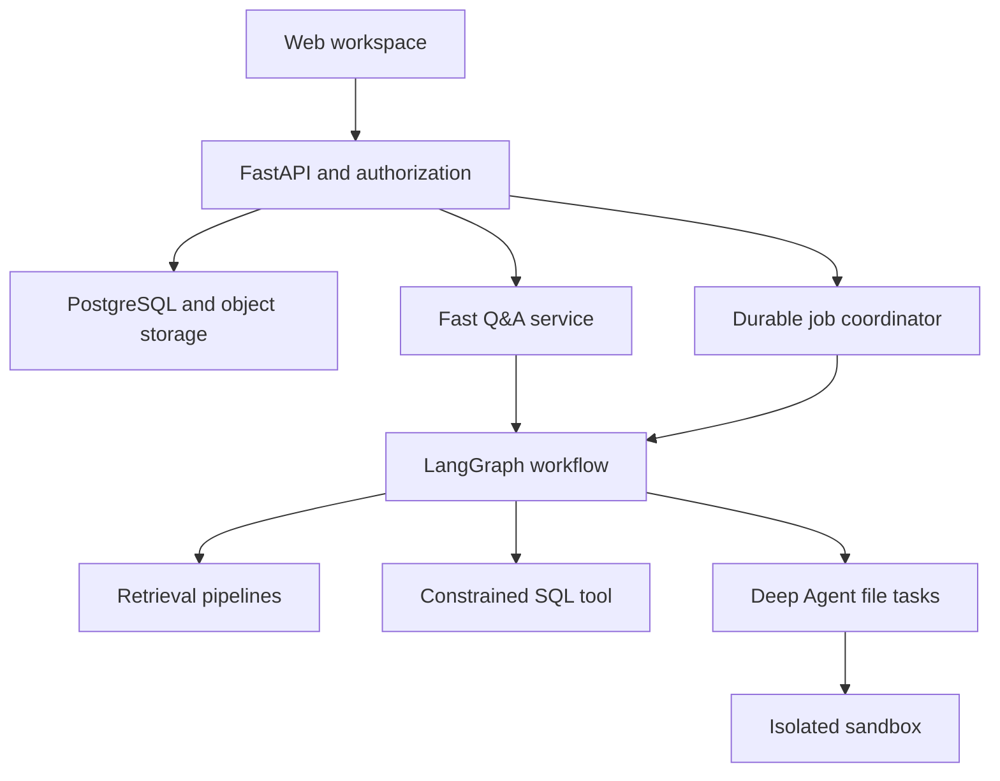

# RAG Foundry — Project Architecture and Implementation Contract

Version: 2.0 · Prepared: 2026-10-14 · Updated: 2026-10-26 · Status: planning blueprint, not an implemented application.

> Agents: read [SUMMARY.md](SUMMARY.md) instead of this file and open only the section a task spec cites. Version 2.0 adds the provider-agnostic layer (§19), the technique plugin system (§20), the in-app Tech Scout (§21) and the open-source goal; the phased plan is [ROADMAP.md](../plan/ROADMAP.md).

## 1. Mission and scope

Build an open-source, provider-agnostic laboratory and document/data workspace for retrieval and knowledge techniques (RAG, GraphRAG, CAG/KAG, caching, agentic workflows and future techniques), with bilingual Arabic/English support as a product feature. Users learn by implementing, inspecting, testing and comparing techniques. Users choose any chat, embedding or reranking provider (local such as Ollama, or paid APIs); no provider is required, and a zero-paid-key local install is a release requirement. The project has four complementary outcomes:

1. An educational laboratory covering the major families of chunking, indexing, retrieval, context construction, generation, and agentic RAG.
2. A usable document/data assistant whose enabled pipelines are selected using measured quality, latency, cost, and access-control results.
3. An independently usable knowledge service with public versioned contracts and portable source bundles for unrelated consumer applications. Integration with book2video is optional and replaceable; no consumer domain concepts enter the RAG core.
4. A public open-source repository that anyone can install with Docker Compose and a local model, extend with technique and provider plugins, and keep current through the in-app Tech Scout.

The architectural decisions in [REUSE_AND_INTEGRATION](REUSE_AND_INTEGRATION.md) and [SOURCE_ANCHORS_AND_MEDIA](SOURCE_ANCHORS_AND_MEDIA.md) are part of this contract from phase 1. The screenshot additions and their exact scope are in [CACHE_AND_KNOWLEDGE_LABS](../techniques/CACHE_AND_KNOWLEDGE_LABS.md).

Every technique in `config/techniques.json` is a curriculum commitment. A technique does not disappear from the curriculum because it loses a benchmark. Losing is a documented result. Production activation is a separate decision. The catalogue is extensible; it is not a claim to contain every published RAG variant forever.

The initial corpus is small, public or owner-authorized, and deliberately includes Arabic, English, mixed text, scanned pages, tables, headings, code, and unanswerable questions. Technical books and manga can stress parsers but cannot validate claims about legal, financial, or compliance suitability. Add a representative domain corpus before making domain claims.

### What exists today

Architecture, roadmap, ADRs, technique catalogue, example configuration, Claude Code instructions/rules/subagents, optional development hooks with tests, templates and a progress ledger. No API, frontend, database, agent, or sandbox application is implemented yet. All technique statuses begin as `planned`. Do not report this package as a functioning RAG product.

### Success definition

- A learner can explain one complete document-to-answer path and inspect its intermediate outputs.
- Every curriculum item has a faithful implementation or an explicitly named adaptation, a demonstration, meaningful tests, comparison evidence, and a limitations note before it is called complete.
- A user can upload authorized documents, ask bilingual questions, inspect exact supporting sources, and receive a calibrated abstention when evidence is missing.
- Long tasks can later combine document retrieval, constrained SQL, and sandboxed calculations to produce downloadable artifacts.
- Experiments are reproducible enough to attribute a change to a technique rather than an unnoticed data/model/config change.
- Tenant boundaries, provenance, cancellation, deletion, and recovery are tested behaviors.

## 2. Product surfaces

| Surface | User action | Visible evidence |
|---|---|---|
| Document workspace | Upload, version, inspect, delete documents | Parsing status, page render, text/table extraction, provenance |
| Chunking Playground | Compare segmentations on the same document | Colored spans, token counts, overlap, heading paths, parent IDs |
| Retrieval Playground | Search using several strategies | Candidate ranks, branch scores, fusion scores, filters and rerank changes |
| Pipeline Builder | Select compatible components | Effective immutable config, requirements, budget and validation errors |
| Experiment Dashboard | Run paired comparisons | Per-question outputs, aggregate metrics, latency distribution, cost, failures |
| Assistant | Ask document/data questions | Streamed answer, claim-to-source citations, abstention, tool activity |
| Task workspace | Request an analysis/report | User-facing progress, approvals, artifacts, cancel/resume controls |
| Cache/knowledge experiments | Compare CAG/KAG and cache profiles | Actual hits, source grounding, cold/warm latency, freshness and false-hit evidence |
| Portable source inspector | Inspect/resolve/export source anchors | Versioned structure, authorized selectors, explicit precision and missing-asset states |
| Technique lessons | Learn a curriculum item | Intuition, mechanism, worked example, runnable demo, failure case |

Progress displays show operations and concise decision summaries, not private chain-of-thought. Raw source text is displayed only to authorized viewers. Arabic UI uses RTL while code and numeric identifiers remain readable LTR.

## 3. Architecture decisions

| Concern | Decision | Boundary |
|---|---|---|
| Backend | FastAPI, Pydantic schemas | HTTP/auth/validation; no heavy OCR or embedding in request handlers |
| Persistence | SQLAlchemy 2 async + Alembic + PostgreSQL | Domain records and migrations; a session per request/task unit, never shared concurrently |
| Text vectors | pgvector initially | Keep embedding spaces/versioned indexes separate |
| Files/artifacts | Local object-store adapter in development; S3-compatible adapter later | Database stores metadata and object keys, not large file bodies |
| Model providers | Own `packages/providers` ports (chat, embeddings, reranker) with a LiteLLM-backed adapter; native adapters allowed ([ADR-0001](../decisions/ADR-0001-provider-agnostic-layer.md)) | Domain code never imports a vendor SDK; capability flags and per-pipeline model choice |
| Techniques | Plugin registry in `packages/techniques` keyed by catalogue ID ([ADR-0002](../decisions/ADR-0002-technique-plugin-system.md)) | New technique = plugin + catalogue entry, no core change |
| Tech Scout | Scheduled job in the worker, `packages/scout` ([ADR-0003](../decisions/ADR-0003-in-app-tech-scout.md)) | Writes reports and `proposed` entries only; a human approves |
| Model/tool frameworks | LangChain/LangGraph where they help, wrapping our provider ports | Framework objects stay out of domain contracts |
| AI workflow | LangGraph | Routing, bounded correction, state, checkpoints, human interruptions |
| Complex file tasks | Deep Agents | Only where filesystem operations, decomposition, context management or delegated work help |
| AI observability/evaluation | OpenTelemetry spans by default plus optional LangSmith; both can run together ([ADR-0006](../decisions/ADR-0006-observability-otel-and-langsmith.md)) | Complement application audit/events; redact sensitive content; no SaaS required |
| Background orchestration | Worker with a pluggable job engine: PostgreSQL-backed queue and scheduler by default, Temporal as a supported option ([ADR-0005](../decisions/ADR-0005-pluggable-job-engine.md)) | Ingestion/batch experiments/long jobs/weekly Scout; not required for each fast Q&A |
| Cache/live notifications | Redis as needed | Never the only durable source of job status or approval state |
| Live UI | SSE first | Durable sequence IDs permit replay of persisted events |
| Frontend | React + TypeScript + Vite, TanStack Query | Thin client over versioned API contracts; keyboard and RTL support |
| Execution isolation | Dedicated sandbox service/provider | Agent has constrained execution tools; API process does not run generated code |
| External tools | Official MCP servers + LangChain MCP adapters | Authentication and authorization remain explicit |
| Development | Python 3.11+ starting baseline, uv; Node LTS and pnpm for UI | Verify library compatibility and lock exact versions in P1.1 |

Do not add LangServe, multiple vector databases, or multiple tracing platforms merely to collect names. A comparative adapter may be added as a lesson with a stated question. Do not force every deterministic transform into an agent.

LangChain, LangGraph, Deep Agents, and LangSmith have complementary responsibilities. They are not four independent copies of the same loop. A graph may invoke a specialized deep agent, but every workflow must identify which layer owns control and persistence. Exact imports and version-specific APIs must be verified against current official documentation before implementation.

## 4. System relationships

LangSmith traces AI spans across these components. Application events/audit records remain in PostgreSQL. Files are scoped object-store artifacts. Redis can accelerate delivery but is not depicted as a source of truth. Later, Temporal owns the durable coordinator. This diagram expresses responsibilities, not a requirement to deploy ten services immediately.

### Fast question path

Authenticate → resolve authorized project and index version → validate config → retrieve → optionally rerank/compress → pack context → generate structured answer → check citations → stream/persist result. Use a direct pipeline for predictable questions; use a bounded graph when routing or correction is needed.

### Ingestion path

Authorize upload → enforce byte/type limits and hash content → preserve immutable source version → inspect file/page types → extract text/layout/tables/OCR → normalize without losing source mapping → chunk → construct representations → embed/index → validate counts and provenance → atomically activate the new index version. Failed or partial indexes never silently replace active ones.

### Long task path

Create task and idempotency key → schedule durable work → route document/SQL/file work → request approvals where required → run computations in sandbox → validate and store artifacts → finish task and release resources. Cancellation must reach provider calls when possible, workers, and sandbox cleanup. An external call already completed cannot be undone by setting `cancelled` in a database.

## 5. Repository target structure

The following directories are the planned application layout. The starter contains only configuration/docs/hooks/tests; create application modules incrementally.

| Path | Responsibility |
|---|---|
| `apps/api/` | FastAPI routes, dependencies, authorization, API serialization |
| `apps/worker/` | Job entrypoints, Temporal workflows/activities, recovery and cleanup |
| `apps/web/` | React UI, playgrounds, experiment dashboard, chat/task UI |
| `packages/domain/` | Framework-light types, IDs, policies, domain errors |
| `packages/ingestion/` | File probes, parsers, OCR, provenance and normalization |
| `packages/chunking/` | Strategy interfaces, implementations, span inspection |
| `packages/indexing/` | Index lifecycle, representations, embedding profiles |
| `packages/retrieval/` | Dense/sparse/fusion/rerank/graph/visual retrieval |
| `packages/context/` | Packing, compression, attribution, token budgeting |
| `packages/agents/` | LangGraph workflows, LangChain tools, Deep Agents integration |
| `packages/evaluation/` | Datasets, evaluators, experiments, reports |
| `packages/storage/` | SQLAlchemy repositories, object stores, migrations |
| `packages/sandbox/` | Provider port, constrained execution, resource lifecycle |
| `packages/providers/` | Provider ports, registry, capability flags, LiteLLM/native adapters, usage/cost metering |
| `packages/techniques/` | Technique plugin protocol, registry, catalogue loader and validation |
| `packages/scout/` | Tech Scout fetchers, dedup, triage, report and proposal store |
| `packages/integrations/` | MCP and external tool adapters |
| `packages/contracts/` | Framework-neutral public DTOs, schemas and contract fixtures |
| `packages/provenance/` | Extraction views, source anchors, selectors and resolution |
| `packages/export/` | Authorized portable source bundles and validation |
| `packages/cache/` | Scoped response-cache policies and adapters; inference KV state stays in serving adapters |
| `sdk/` | Optional versioned HTTP client; no server-internal imports |
| `examples/consumer/` | Generic optional integration fixture; no book2video application |
| `config/` | Technique registry and experiment profiles |
| `docs/architecture/`, `docs/plan/` | Architecture, summary, roadmap, agent workflow |
| `docs/techniques/` | Catalogue and one lesson/evidence record per technique |
| `docs/decisions/` | Architecture decision records |
| `tests/` | Contract, integration, adversarial and recovery tests |

Start with a modular monolith plus a separate worker. Directory boundaries do not require separate deployments or Python distributions. Avoid microservice overhead until a concrete scaling or isolation need exists.

## 6. Domain contracts and storage

Every domain record carries tenant/project scope where applicable. IDs from a request never substitute for authorization. Do not trust a model-supplied `tenant_id`, `user_id`, object key, connection string, or unrestricted filesystem path.

| Entity | Essential fields and invariants |
|---|---|
| Organization / Membership / Project | Role membership, scope, explicit access policy |
| Document | Logical identity, owner scope, lifecycle state |
| DocumentVersion | Immutable original content hash, MIME and object key; extraction views versioned separately |
| ExtractionView | Document version, immutable canonical text/layout, parser/OCR/normalization profile and hash |
| SourceBlock / Section | Source structure and reading order; independent of retrieval chunks and consumer lessons |
| SourceSpan / SourceAnchor | Pinned source and extraction IDs, block-relative code-point ranges, quotes, geometry/path, precision/status; stable across reindexing |
| SourceBundle | Contract version, source/extraction snapshots, manifest/asset hashes, export policy and lifecycle |
| Chunk | ID stable within one index/profile, source anchor references, text, token count, heading path, parent ID |
| Representation | Chunk/page/entity ID, type, generated/raw flag, model/prompt version, source links |
| EmbeddingProfile | Model+revision, tokenizer, preprocessing, dimensions, normalization, distance metric |
| IndexVersion | Corpus snapshot hash, ingestion/chunking/embedding config, lifecycle, artifact references |
| PipelineVersion | Validated resolved config, code revision, dependencies, capability requirements |
| DatasetVersion / EvaluationCase | Frozen question set, relevance labels, expected facts/citations, cohort/split |
| Experiment / CaseResult | Pipeline+dataset versions, raw results, metrics, budgets, hardware/provider and failures |
| Thread / Message / Run | Authorized scope, pipeline version, status, token/cost usage, trace ID |
| Task / TaskEvent | State machine, durable ordered events, idempotency key, attempt metadata |
| Approval | Actor scope, action name, argument hash, expiry, decision and one-time execution status |
| Artifact | Tenant scope, object key/hash/MIME/size, origin run, retention |
| AuditEvent / OutboxEvent | Actor, action, target, outcome; transactional intent for external delivery |

LangGraph checkpointer/store schemas are separate from business tables and use the framework's supported storage/migration mechanism. SQLAlchemy does not need to own those tables. Bind thread namespaces to authenticated project scope and check authorization on resume as well as initial invocation.

### Retrieval and answer contracts

- `RetrievedEvidence`: source IDs/spans, representation ID, branch, raw score, final rank, index version, access scope. Scores from different models are not inherently comparable.
- `Answer`: answer text, individual factual claims, citation references, abstention flag/reason, warnings, run ID and usage summary. A citation must resolve to authorized original evidence.
- Synthetic questions, summaries and contextual prefixes must be marked generated. They can retrieve a source but cannot invent page evidence.
- Empty retrieval and invalid source mapping are first-class outcomes; do not fill them with plausible citations.

### Data isolation and deletion

Apply authorized filters before candidate exposure, then recheck before generation and display. Include tenant/project/corpus/model/pipeline scope in caches. Test ANN filtering behavior for both recall and isolation. RLS can add defense in depth when configured with a non-bypass application role and transaction-scoped context.

Deletion revokes document access immediately, then purges derived chunks, embeddings, graphs, visual indexes, object versions, caches and permitted trace copies according to retention policy. Jobs pinned to a deleted source must fail or exclude it; stale cache hits must not resurrect access.

## 7. Chunking curriculum

The catalogue enumerates concrete entries C01–C21. It distinguishes segmentation from enrichment/representation, even when a technique affects both.

Required families: character/word/token fixed-size; overlap; recursive; sentence/paragraph; Markdown/HTML/JSON structure; page/layout/table-aware; language-aware and AST code splitting; embedding-semantic; LLM boundaries; propositions; parent–child; adaptive policies; late chunking.

Every strategy preserves provenance and exposes deterministic configuration where possible. Handle oversized tables/code blocks explicitly (split with repeated headers and lineage, or emit a flagged oversized object); never promise that an arbitrarily large table always fits a context window. Arabic normalization must retain mappings back to original text and avoid silently changing meaning.

For LLM chunking: structured outputs, boundaries grounded in source offsets, bounded retries, caching keyed by source/model/prompt, and a no-loss/no-unsupported-invention check. For propositions: allow overlapping source spans and deduplicate; verbatim reconstruction may not apply, but claim support must.

For late chunking: use a compatible encoder exposing token-level representations, pool after contextual encoding, record truncation/window effects, and compare against early chunking with the same model. A normal embedding API returning one vector per supplied chunk does not implement it.

## 8. Retrieval and RAG curriculum

The catalogue covers retrieval primitives, query transforms, representations, workflows and research architectures as separate types. A pipeline composes compatible types rather than selecting one marketing name.

### Baselines and retrieval

Implement no-retrieval control, dense RAG, BM25, PostgreSQL FTS comparison, learned sparse retrieval, hybrid fusion, RRF, weighted fusion with calibration, MMR, deduplication, metadata filtering and self-query. PostgreSQL `ts_rank` is not BM25. Arabic FTS with `simple` is not a complete Arabic linguistic analyzer.

### Query transformation

Implement rewrite, multi-query, decomposition, step-back, HyDE and RAG fusion. Preserve the original question in evidence/evaluation. HyDE output is a search aid, never source evidence. Prevent query transforms and filters from expanding the user's authorized scope. Count all model calls in cost and latency.

### Reranking and context

Compare cross-encoder and LLM rerankers; multi-vector representations; contextual enrichment; sentence windows; parent retrieval; hierarchical auto-merging; compression; ordering and budgeting. Revalidate provenance after transformations. Compression must preserve dates, negation, units, conditions and attribution.

### Workflows

Conversational RAG, constrained SQL retrieval, multi-source routing, bounded corrective loops, explicit self-checking, adaptive routing, agentic multi-hop, and multi-agent comparisons. A fast path must remain available. Store visited queries/evidence hashes, enforce step/time/token/tool budgets, and define a safe exit for no progress.

Web fallback is opt-in at project/pipeline level. It must not disclose private documents in search queries. Label web evidence separately and never silently present public-web answers as internal-policy evidence.

### Additional knowledge and caching tracks

The catalogue contains 72 entries. R47 adds bounded-context CAG; R48 adds schema/logical-form KAG; R49 adds inference prefix reuse; R50/R51 add exact and semantic response caching. Implement all as measured experiments with optional adapters. These are not five interchangeable RAG architectures. See [detailed contracts](../techniques/CACHE_AND_KNOWLEDGE_LABS.md). Preserve original evidence and cache isolation; do not present cached responses as fresh retrieval.

### Research and visual tracks

- RAPTOR: recursive clustering/summarization with a retrievable hierarchy and original-source lineage; a flat list of summaries is not a faithful implementation.
- GraphRAG: entities, relations and graph-backed retrieval; a separate community/global-summary track. Neighboring text chunks alone are not entity GraphRAG.
- Self-RAG: separate prompt-based self-checks from the paper's trained reflection-token approach. Use compatible official model/implementation for a faithful inference lab; training from scratch is an optional extension, not a hidden prerequisite.
- CRAG: distinguish a bounded relevance/rewrite adaptation from full research reproduction; document the omitted pieces.
- Multimodal: text/table extraction, captions connected to originals, image-page retrieval and visual generation. Keep generated captions distinct from visual evidence.
- ColPali-style retrieval: multivector page and query representations with late interaction. It requires a supported scoring/index path; do not put it blindly into a single text-vector column.
- Multilingual: Arabic/English/mixed cohorts and cross-language queries, without assuming multilingual model branding guarantees domain quality.

Resource-heavy entries remain committed backlog items with explicit hardware/model requirements. Implement educational adaptations first when useful, but keep faithful reproduction status separate. A simulation must be labeled `simulation`; random embeddings cannot be presented as a working retriever.

## 9. Pipeline configuration and compatibility

`config/experiment.example.json` is a design contract, not a currently executable application config. Phases 1–3 (P1.2, P3.4) must implement strict Pydantic validation and a resolver before offering the UI builder.

Resolved profiles contain: corpus snapshot, extraction/chunking profile, embedding profile, index version, retrieval branches, fusion, reranker, transforms, context construction, generator, workflow, budgets, evaluator/dataset versions and privacy policy.

Reject unknown fields and unknown strategy IDs. Never silently fall back from an unavailable advanced strategy to dense search while retaining the advanced label. Reject unavailable models and incompatible index types before starting a costly job.

### Rebuild matrix

| Change | Required action |
|---|---|
| Source bytes/extraction/normalization/chunk boundaries | New document/index lineage; rebuild affected representations and embeddings |
| Embedding model/revision/tokenizer/preprocessing/metric | New embedding profile and compatible index; dimension equality is insufficient |
| Contextual prefixes or generated indexing representations | Rebuild affected representations and their embeddings |
| Top-k/fusion/reranker/query rewrite/prompt | New pipeline/experiment version; reuse compatible immutable indexes |
| Graph extraction/community settings | New graph artifacts and derived summaries |
| Visual encoder/page rendering | New visual index and page lineage |

Validate capabilities such as `token_embeddings`, `multivector`, `vision_generation`, `graph_index`, `structured_output`, `sandbox_execution`, and `readonly_sql`. Optional adapters are loaded only for selected profiles. Pin a successful dependency set in lockfiles; do not guess future package versions in this blueprint.

## 10. APIs and task semantics

Version under `/api/v1`; these are proposed contracts, not existing endpoints. Publish framework-neutral OpenAPI/JSON with capabilities and source resolution/export contracts from [integration design](REUSE_AND_INTEGRATION.md). Consumer code owns its adapter and provider interface; no shared database or cross-repository imports.

| Endpoint | Behavior |
|---|---|
| `POST /projects/{id}/documents` | Validate upload; return document/version and ingestion task |
| `GET /documents/{id}/versions/{version}` | Authorized status, metadata and source locator |
| `POST /projects/{id}/indexes` | Build immutable index profile; idempotency key required |
| `POST /projects/{id}/retrieve` | Return inspectable authorized evidence and score components |
| `POST /projects/{id}/runs` | Create Q&A or task run; pin pipeline version |
| `GET /runs/{id}/events` | SSE replay from event sequence / Last-Event-ID |
| `POST /runs/{id}/cancel` | Idempotent cancellation request |
| `POST /approvals/{id}/decision` | Authorized decision tied to immutable action arguments |
| `POST /projects/{id}/experiments` | Frozen paired comparison, budget and dataset version |
| `GET /experiments/{id}` | Per-case results and aggregate report |
| `GET /artifacts/{id}` | Authorized download or short-lived scoped URL |
| `DELETE /documents/{id}` | Revoke access and schedule derived-data purge |

Task state: `queued → running → awaiting_approval → running → succeeded`; from active states allow `cancel_requested → cancelled`, and explicit `failed`. Transitions are validated; completion/cancellation races have tests. Events include unique IDs, sequence, type, timestamp and safe payload. Token deltas may be ephemeral, but persist final messages and essential state transitions.

Return structured errors with code, safe message, request/run ID and retryability. Do not expose stack traces, tokens or database URLs to end users. Use upload limits, rate limits and bounded pagination. Treat artifacts as untrusted downloads; do not render arbitrary generated HTML with application credentials.

## 11. LangGraph, Deep Agents and durable-job ownership

The durable job engine is pluggable (ADR-0005): PostgreSQL-backed queue by default, Temporal optional. Where this section says Temporal, read "the durable job engine".

LangGraph state includes original question, authorized scope reference, selected pipeline, evidence IDs, workflow progress, budgets, approval reference and output. Keep large files out of checkpoints; use object IDs. Use a persistent checkpointer for recovery milestones; in-memory state is only for explicitly local demonstrations.

A Deep Agent gets narrowly scoped tools for retrieval, readonly data access and sandbox work. Subagent tools inherit or reduce parent permissions and budgets. Limit fan-out; compare against a single-agent baseline. Tool outputs and retrieved instructions are untrusted data.

Temporal orchestrates long business/job lifecycle; external I/O and AI calls happen in activities, not replayed workflow code. A graph can run inside an activity with durable thread/run identity and heartbeat. Design approval suspension to avoid keeping expensive sandbox processes alive while waiting.

Define retry ownership in an ADR: network retry at adapter boundary, domain-correction loop in graph, job retry in Temporal. Cap each, propagate cancellation, and avoid multiplicative retries. External writes require idempotency keys or explicit duplicate detection; do not claim exactly-once delivery across systems.

Use transactional outbox for committed job/action events when needed. Redis pub/sub alone is not durable dispatch. Record Temporal workflow/activity IDs and graph thread/checkpoint IDs alongside application run IDs.

## 12. Sandbox, SQL, MCP and approvals

### Sandbox

Separate runtime agent sandboxing from the development hooks shipped here. Hooks are assistance for the coding agent; they do not isolate generated application code.

Sandbox port: create scoped workspace, stage authorized inputs, execute with timeout/resource limits, inspect/download allowed outputs, cancel, destroy. It returns structured exit status, bounded output, usage and artifacts. Use a dedicated worker/provider; never execute generated code in FastAPI or on the learner's general host shell.

Enforce non-root execution, read-only base filesystem where practical, dropped capabilities, no-new-privileges, CPU/memory/PID/disk/output/time limits, explicit network policy, path traversal/symlink handling and cleanup. No Docker socket or broad host mount inside the agent sandbox. Model/service credentials stay outside code execution; expose brokered tools when necessary.

A hardened container is a development baseline, not proof of a sufficient hostile multi-tenant boundary. Evaluate a microVM/managed sandbox or another stronger isolation design before untrusted shared production. Test network denial instead of assuming a named Docker bridge enforces an allowlist.

### SQL

Separate application persistence from the analytics datasource. The model gets schema descriptions and constrained readonly query tools, not credentials. Use readonly database roles, allowed schemas/views and row-level scope; parse/validate query structure, restrict functions, bound runtime/results, and handle expensive queries. `SELECT`, `LIMIT`, or SQLAlchemy by themselves do not guarantee safe SQL. Show query and source lineage; do not expose application secrets/auth tables.

### MCP and actions

MCP is a protocol, not an authorization system. Authenticate connections, allowlist tools, validate schemas, enforce tenant scope server-side, and budget/tool-timeout every invocation. Treat tool descriptions/results as untrusted external content.

Approval is for an exact action name + canonical argument hash + authorized actor + expiry. Revalidate permission and hash at execution, consume once and audit the outcome. Changed arguments require a new decision. Do not ask for repeated approval for ordinary already-authorized local development work. Sending messages, deployment or external destructive actions require appropriate explicit task authorization.

## 13. Evaluation and scientific comparison

Keep educational completion separate from production eligibility. Maintain development, validation and frozen held-out splits; avoid document/near-duplicate leakage. Begin with a few manually checked cases per failure class, then grow the representative set. Synthetic questions need human review and must not contaminate held-out labels.

| Layer | Evidence and metrics |
|---|---|
| Extraction | Reading order, table fidelity, OCR errors, provenance coverage |
| Chunking | Boundary examples, source coverage, duplication, size distribution, downstream retrieval |
| Retrieval | HitRate@k, Recall@k, Precision@k, MRR, nDCG with documented relevance labels |
| Answer | Claim support, correctness, relevance, citation accuracy/coverage, abstention |
| Agents | Task completion, tool correctness, budget adherence, approval/cancellation/recovery |
| Operations | TTFT, end-to-end p50/p95, ingestion throughput, storage, token and compute usage |
| Security | Cross-tenant negative cases, malicious document/tool content, denied SQL/network/filesystem actions |

HitRate@k is whether any relevant item is found. Recall@k is the fraction of labeled relevant items retrieved. For one relevant item they coincide; do not generalize this to multiple relevant chunks. Ground truth should prefer source spans/facts when comparing chunkers, since chunk IDs change across indexes. Derive relevance labels for each index through source-span overlap and human review where ambiguous.

For each comparison freeze corpus, dataset, base model, hardware/provider settings and unrelated pipeline fields. Run single-variable ablations before interaction experiments. Persist raw per-case evidence and failures, repeated runs when stochastic, sample counts, uncertainty estimates when useful, and all paid/auxiliary model calls. Separate cold/warm cache and concurrency conditions.

LLM-judge scores are evaluator outputs, not guaranteed truth percentages. Version rubrics/judge models, calibrate a human-reviewed subset, and use deterministic validators for citations/schema/security. A high average quality score cannot override an access-control failure.

Initial product aspirations inherited from RAG Lab (faithfulness .95, relevance .90, retrieval .90, p95 5s, $0.05/query) are provisional hypotheses, not universal gates. Calibrate by cohort and task class. Fast Q&A, visual extraction and a long report have separate budgets. Report local compute/storage costs separately from zero API spend. Temperature zero is not a determinism guarantee.

## 14. Teaching workflow and definition of done

For each technique use `docs/templates/TECHNIQUE.md`. Explain in the user's language with English technical terms; code, identifiers and repository docs are English. The product UI is bilingual Arabic (RTL) and English (LTR). Teach one concrete question before the abstract mechanism. The owner should inspect the output, predict one behavior and understand one failure mode; do not force a quiz before every reversible action.

Implement one bounded vertical slice at a time. Explain inputs, outputs and changed files before implementation; continue authorized work without asking for permission after every file. End with what works, how it was verified, what remains, and one useful next experiment.

An item is `validated` only with implementation, source/fidelity note, provenance/contract checks, runnable demo, measured comparison and failure analysis. It can be `production_eligible` only after separate workload-specific quality/operational/security evidence. A resource blocker is recorded, not silently removed or falsely completed.

## 15. Phases and dependency order

The authoritative plan is [ROADMAP.md](../plan/ROADMAP.md): 10 phases x 5 steps, with a usable thin vertical slice at the end of phase 3. Every catalogue entry carries `phase` and `roadmap_step` in `config/techniques.json`. The former milestones map as follows.

| Old | New phase(s) | Note |
|---|---|---|
| M0 foundations | P1, P2 | Provider layer is new and comes before ingestion |
| M1 vertical baseline | P3 | Ends with the first grounded, cited answer on a local model |
| M2 chunking | P4 | Includes portable source bundle round trip |
| M3 retrieval/query/reranking | P5 | |
| M4 representations/context | P6 | Together with the evaluation harness and citation checks |
| M5 LangGraph workflows | P8.1-P8.2 | |
| M6 SQL/MCP/Deep Agents/sandbox | P8.3 | |
| M7 advanced research/visual | P7 | With plugin system v1, GraphRAG, CAG/KAG |
| M8 durable operations, caches | P8.4 (jobs), P7.4 (caches R49-R51) | |
| M9 representative release | P10 | Plus open-source release hardening |
| (new) | P2, P7.1, P8.5, P9, P10 | Providers, plugin system, Tech Scout, UI, OSS release |

Evaluation and isolation begin at P3 and deepen throughout; later phases are not permission to postpone authorization. Phases are capability gates, not calendar estimates.

### First coding-agent task

Roadmap step P1.1. The planner writes a task spec in `docs/tasks/`; see [AGENT_WORKFLOW.md](../plan/AGENT_WORKFLOW.md).

## 16. Reference systems and reuse policy

Some durable-workflow ideas (API/worker separation, scoped credentials, action approvals, task events, ephemeral execution, cleanup) were informed by reviewing other systems. No third-party or proprietary source code is copied into this repository; all implementations are original. Confirm license compatibility before reusing any external code.

## 17. Sources and implementation discipline

The supplied RAG Lab plan and PDFs inform scope, not verified implementation quality. Their sample code and benchmark claims must be checked independently. Official docs and original papers are the implementation references in `docs/SOURCES.md`.

Check versions before writing imports. Record deviations from papers. Never use placeholder/random vectors as real retrieval, never mark a config-only switch as implemented, and never claim the working hooks prove the application exists. Keep `config/techniques.json`, technique pages and progress ledger consistent.

Any scope change that removes a committed curriculum entry must be discussed explicitly. Routine implementation choices, adapters and refactors can proceed within the agreed scope. Architectural changes affecting data lineage, persistence ownership, tenant isolation or research fidelity need an ADR and explanation.

## 18. External consumers and bidirectional source navigation

RAG Lab owns versioned knowledge and evidence. book2video owns lesson/script planning, TTS, rendering and the mapping from script statements to final video time ranges. The provider API or exported source bundle is the optional boundary. Both applications must remain independently buildable and usable with their own data/providers. A selected live integration depends on its service for that operation; offline imported assets remove that dependency for existing source/video playback, not for new retrieval.

Stable source anchors survive rechunking; new OCR/source editions create explicit versions. A paragraph may link to several clips, and a clip may explain several paragraphs. Consumer-owned link manifests support both directions through indexed source-range and media-time lookups. Actual audio alignment plus final rendering transforms supply timestamps; RAG retrieval does not generate exact video timings. Geometry precision is explicit, especially for scanned PDFs.

Source structure is not a chunking policy or a course outline. Enrichment keeps web snapshots/citations separate from the original book. Source-only mode makes no web calls. Consumer terminology such as “Beyond the book” belongs in the consumer UI. Full field conventions, lifecycle, endpoint proposals and acceptance gates are maintained in the linked design documents above.

## 19. Provider-agnostic model layer

Chat, embedding and reranking models are reached only through ports in `packages/providers`. A registry lists configured providers and models with capability flags (`tool_calling`, `structured_output`, `vision`, `context_window`, `embedding_dim`, `token_embeddings`, `cost_per_mtok_in/out`, `local`). Each pipeline stage (generator, embedder, reranker, query transformer, judge, scout) selects its own model profile; validation rejects a profile lacking a required capability before a job starts. Secrets come from environment variables; model choices come from a versioned provider file or the settings UI. Keys never enter pipeline configs or traces. The default adapter is LiteLLM; native SDK adapters may implement the same port when a provider feature requires it. Local providers (Ollama, LM Studio, vLLM, any OpenAI-compatible server) are first-class and form the zero-key default. Embedding-space identity includes provider, model, revision and preprocessing. Details: [ADR-0001](../decisions/ADR-0001-provider-agnostic-layer.md), example `config/providers.example.json`.

## 20. Technique plugin system

A technique is a plugin implementing a typed protocol for its kind (`chunker`, `retriever`, `fusion`, `query_transform`, `reranker`, `context_builder`, `workflow`, `graph_builder`, `knowledge_store`, `cache`, `evaluator`) and declaring its catalogue ID, required capabilities and config schema. The registry discovers built-in plugins and third-party packages through Python entry points. The catalogue (`config/techniques.json`, schema v2) records category, implementation status, catalogue status (`accepted`, `proposed`, `rejected`, `deprecated`), primary source, date added and roadmap step. Adding a technique needs a plugin, a catalogue entry and a lesson page; no core change. Unavailable plugins fail explicitly. Details: [ADR-0002](../decisions/ADR-0002-technique-plugin-system.md).

## 21. Tech Scout

A weekly scheduled job in the worker searches allowlisted sources (arXiv, GitHub, official blogs), deduplicates findings against the catalogue and earlier runs, triages them with a configurable model (default Claude Opus 5.5) under a hard cost cap, and stores a cited report with `proposed` catalogue entries. A human approves or rejects in the UI or API. The Scout never edits the roadmap, catalogue file or code. Fetched content is untrusted input. Details: [ADR-0003](../decisions/ADR-0003-in-app-tech-scout.md), example `config/scout.example.json`.
