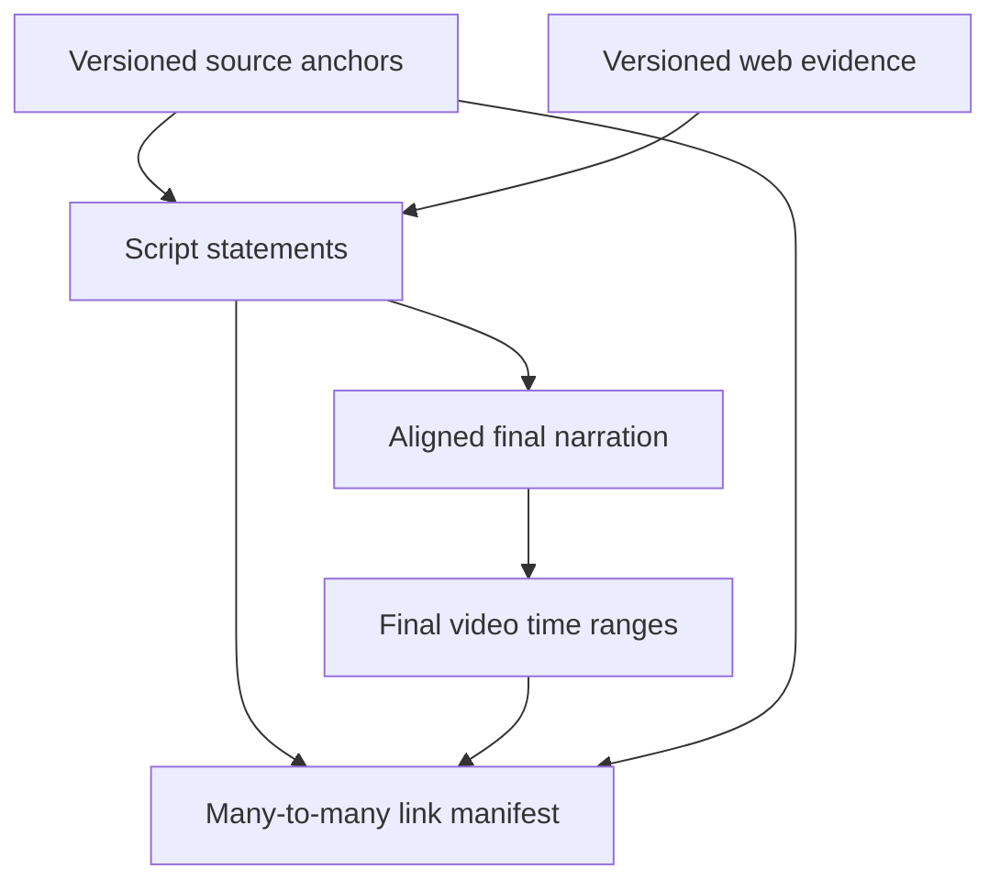

# Source anchors and downstream media alignment

Status: proposed contract and consumer guidance, 2026-10-26. No video renderer or alignment engine is implemented in this package.

## 1. Separate source identity from retrieval identity

Use `Document → DocumentVersion → ExtractionView → SourceBlock/SourceSpan` as the immutable provenance foundation. A `Section` refers to source blocks and other sections. Chunking/indexing reference this foundation without owning it.

- `DocumentVersion`: immutable original bytes/hash, provider-qualified identity and media type.
- `ExtractionView`: immutable extraction result with its own ID/hash, parser/OCR/profile versions, text normalization contract and layout coordinate convention. Re-extraction of identical source bytes can yield different text; it creates a new view.
- `SourceBlock`: ordered paragraph, heading, table, caption, image or code block with source geometry/path; segmentation version is pinned.
- `SourceAnchor`: stable reference to one or more exact spans/regions within a pinned view. No chunk or index ID is necessary for resolution.
- `Chunk`: retrieval unit stable only inside its particular index/profile; it refers to one or more source anchors. Generated propositions and summaries preserve their original support references.

Changing semantic to recursive chunking, overlap or embedding models must not replace source anchors. Re-OCR, document edits or changes to canonical text create new versions. Keep old anchors valid while their versions are retained and authorized; optionally create a reviewed migration map. Never silently point an old link at a similar paragraph in a new edition.

## 2. Locator conventions

| Field | Required meaning |
|---|---|
| `provider_namespace` | Stable logical provider identity; not an expiring signed URL |
| `document_id`, `document_version_id`, `extraction_view_id`, `anchor_id` | Opaque immutable identity tuple; version IDs verified by the resolver |
| `block_id` and `section_path` | Block identity plus human navigation context; heading text alone is not unique |
| `start`, `end` | Zero-based, half-open Unicode code-point range in the specified immutable canonical block text, not UTF-8 bytes or JS UTF-16 code units |
| `exact`, `prefix`, `suffix` | Verbatim quote and disambiguating context when permitted; validate against pinned text |
| `page_index`, `page_label` | Zero-based physical PDF page index versus displayed printed label; never substitute one for the other |
| `regions` | Zero or more page regions: normalized [0,1] rectangles with top-left origin in the stored upright page view; store crop/rotation/render transform back to the original PDF |
| `precision`, `resolution_status` | Exact text/region, approximate region, page-only or unavailable; explicit ambiguity/confidence and extraction warnings |

Coordinates and text offsets serve different purposes. PDF geometry requires actual parser/OCR alignment; an exact text quote is not proof of pixel-accurate highlighting. Multiple columns, line wraps and multi-page spans require multiple regions. Table/cell and image-region references may legitimately have no text range. EPUB uses an edition-pinned spine/resource locator (optionally CFI); HTML uses an immutable captured page plus DOM/text selectors. Do not invent page numbers for pageless formats.

Arabic normalization, diacritics and ligatures require a reversible mapping between canonical search text and the original render. The UI converts code-point indices explicitly before using UTF-16 string APIs. Repeated paragraphs require block/version identity plus contextual selectors. A fuzzy quote match may suggest candidates but must be marked approximate or unresolved until accepted.

These selectors are informed by the [W3C Web Annotation Data Model](https://www.w3.org/TR/annotation-model/). The custom v1 JSON is not claimed to be a conformant JSON-LD serialization; use an explicit adapter if W3C interchange is needed.

## 3. Where video timing belongs

book2video owns the following chain; RAG Lab supplies the source references on the left:

Keep an explicit semantic association from script statements to evidence before synthesis. TTS word/sentence timestamps, or forced alignment against the actual narration, provide audio times. Rendering then maps these times through cuts, pauses, intros, speed changes and inserted scenes onto the final video timeline. Forced alignment alone matches speech to a script; it does not determine which book paragraph supports a paraphrase.

A link record contains `link_id`, `script_revision`, `statement_id`, one or more source references, `asset_id`, `asset_version`, media hash, `[start_ms,end_ms)`, relation (`explains`, `quotes`, `illustrates`, `updates`, `contradicts`) and distinct semantic-grounding/timing confidence or review status. All timing is integer milliseconds on the final asset timeline. This is a consumer-owned manifest; no `video_id`, `course_id` or `tts_provider` fields enter RAG Lab's domain tables.

Many-to-many is required: one paragraph can be explained in multiple intervals/videos; one interval can explain several paragraphs; a generated analogy may have no direct quoted span. Do not force a single timestamp per paragraph. `source_refs=[]` is allowed only with an explicit unsupported/original-example classification and must not be shown as a book citation.

## 4. Bidirectional navigation

**Video → source:** find all active intervals at the playhead (`start_ms <= t < end_ms`), resolve their source anchors from the live provider or imported bundle, and highlight the permitted regions. Multiple matches appear as choices/combined highlights. Beyond-source content displays its web references instead of pretending the book contains it.

**Source → video:** take the selected source version/block/span, find link records whose referenced source ranges overlap (or explicitly refer to the same image/table region), and show all matching clips with titles and time ranges. Seek to the selected interval. No match means “not covered in a video”; it must not trigger an invented semantic match.

Store an index by `(asset_version,start_ms,end_ms)` and another by `(provider_namespace,document_version,extraction_view,block_id,source_range)` in the consumer. These are explicit link lookups, not a vector search on every click. Search can help build/review links, but persisted reviewed links drive navigation. Source selection uses overlap rather than equality because a user may select part of a paragraph.

Illustrative UX only: paragraph on printed page 42 ↔ final video at 02:13–02:41. These are example numbers, not measured alignment. Exactness is earned by validation against the rendered asset, never by estimating duration from character count. Edited narration/video invalidates its alignment; create a new asset version and rebuild/review links.

## 5. Optional enriched mode

Consumer decides `source_only` versus `enriched`. Source-only retrieval is explicitly restricted to the chosen document versions. In enriched mode a separate web-evidence branch records URL, title, publisher, available publication/update dates, retrieval timestamp, snapshot/hash and the exact supporting passage. A retrieval date alone does not prove that information is new.

Tag statements as source-based, externally enriched, original illustration or mixed (with per-claim references). “Beyond the book” is a book2video display label, not a core RAG entity. Preserve the original book statement; additions/corrections have their own evidence and review state. Conflicting sources remain visible. Do not label a statement corrected just because a search result disagrees.

RAG Lab can provide generic opt-in public-web retrieval and typed provenance via R44/R35; the consumer may instead own the web provider. Do not duplicate hidden web fallback in both layers. Pass only permitted public concepts to web queries, never entire private excerpts by default. Store snapshots only as permitted; otherwise expose a partial-source state. General answer caching must respect mode and freshness.

## 6. Acceptance fixtures for implementation

- English/Arabic mixed text with diacritics and non-BMP emoji: verify identical code-point selections in backend and UI.
- Two identical paragraphs, rotated/scanned two-column PDF, a split paragraph and a table across pages: no invented precision.
- Same extraction view reindexed by two chunkers: unchanged source references.
- New OCR view and revised book edition: old links remain pinned or explicitly unavailable, never silently migrated.
- One paragraph/two video intervals; one interval/two paragraphs; gap and interval endpoint; partial paragraph selection.
- New audio speed/intro/cut: obsolete times rejected for the new asset version; validate seek and highlight on actual rendered media.
- Source-only mode with zero web calls; enriched correction with separate web citation and original book locator.
- Deleted/inaccessible source and an offline bundle missing its PDF: clear unavailable states without access bypass.

RAG Lab implements/tests the source half using generic consumer fixtures. The future book2video repository implements/tests media alignment and playback. This update creates neither application.
